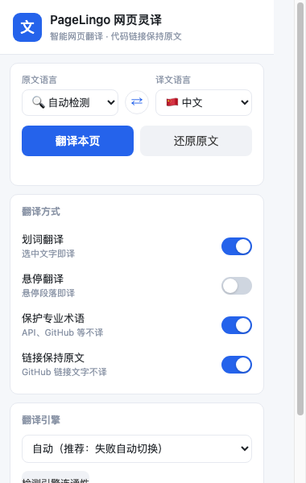
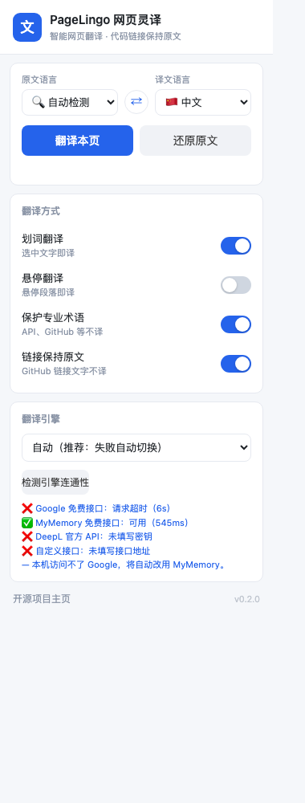
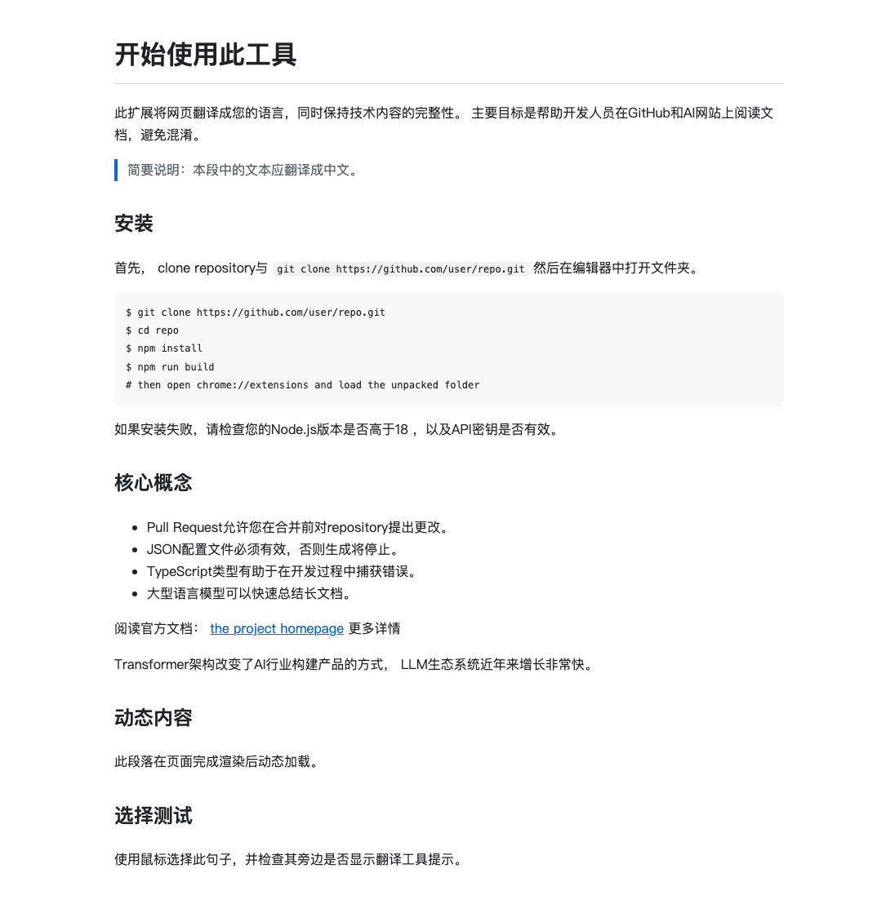

# PageLingo 网页灵译

> 一个开源、免费的浏览器网页翻译扩展。针对 GitHub 与国外 AI 网站做了专门优化——代码、命令、链接与专业术语保持原文，只翻译你真正需要的内容。

[](LICENSE)
[](manifest.json)

## 为什么做它

浏览 GitHub 和国外 AI 站点时，浏览器自带的「整页翻译」会把代码、命令、仓库名、API 名称也一并翻译，反而更难看懂。PageLingo 只翻译自然语言，保留代码与术语，还支持**划词翻译**和**悬停翻译**，是面向开发者与 AI 用户的高精度翻译工具。

## 功能特性

| 能力 | 说明 |
|---|---|
| 全页翻译 | 一键翻译整页自然语言，保持原有排版 |
| 划词翻译 | 选中任意文本即出译文浮层，可复制 |
| 悬停翻译 | 鼠标停在段落上自动翻译（可开关） |
| 代码保护 | `pre`/`code`/命令/路径/哈希/版本号不翻译 |
| 术语保护 | API、GitHub、LLM 等专业术语占位保护，翻译后原样还原 |
| 链接保护 | 链接文字可保持原文（默认开启） |
| 动态内容 | MutationObserver 自动翻译懒加载/动态插入的内容 |
| 多语言 | 中 / 英 / 日 / 韩 / 德 五语两两互译 + 自动检测 |
| 可换引擎 | 内置 Google 免费接口、MyMemory，支持自定义接口 |

## 安装（开发者模式）

本扩展暂未上架应用商店，请手动加载：

1. 下载并解压本项目。
2. 打开 Chrome/Edge，地址栏输入 `chrome://extensions`（Edge 为 `edge://extensions`）。
3. 右上角打开「开发者模式」。
4. 点击「加载已解压的扩展程序」，选择本项目根目录（含 `manifest.json` 的文件夹）。
5. 工具栏出现 PageLingo 图标即可使用。

> 注：Chrome 137 起已移除 `--load-extension` 命令行参数，自动化场景需用 CDP 的
> `Extensions.loadUnpacked`（配合 `--enable-unsafe-extension-debugging`）载入；手动安装不受影响。

## 实测状态（v0.2.0）

在真实 Chrome 157.0.8103.39（macOS）中自动化实测，两套用例全部通过：

| 用例集 | 覆盖 | 结果 |
|---|---|---|
| 本地测试页 | 扩展加载、Popup 渲染、配置写入、内容脚本注入、全页翻译、代码块/行内代码/链接保持、术语保护、动态内容、划词、悬停、还原、引擎连通性自检 | **15/15** |
| GitHub 真实页面 | 359 个文本节点中翻译 163 段，`pre`/`code`/链接逐字未变，页面宽度零变化 | **8/8** |

实测中发现并修复的问题见 [CHANGELOG](CHANGELOG.md)，其中术语保护丢失术语（`GitHub` 被译成「0」）属严重缺陷，已改为「`{{n}}` 占位 → 译后校验 → 分段降级」三重保障。

<p align="center">
  
  
  
</p>

上图左：设置面板；中：一键自检，直接显示哪条翻译链路通、哪条不通；右：代码块与行内代码保持原文，`GitHub`/`AI` 等术语不被翻译。

## 使用说明

- 点击工具栏图标打开设置面板，选择**原文语言**与**译文语言**。
- 点「翻译本页」进行全页翻译，点「还原原文」撤销。
- 「划词翻译」默认开启；「悬停翻译」默认关闭，按需打开。
- 翻译引擎默认 **自动**：依次尝试 Google → MyMemory → DeepL → 自定义，第一个成功的即采用。
- 若不确定为什么翻译不了，点面板底部「**检测引擎连通性**」，会逐个实测并显示哪条链路不通。

## 翻译引擎与注意事项

| 引擎 | 是否需要密钥 | 说明 |
|---|---|---|
| **自动（默认）** | 否 | 按序尝试并自动切换；失败引擎冷却 10 分钟，避免每次空等超时 |
| Google 免费接口 | 否 | 非官方接口，速度快、质量好，偶有限流；**中国大陆网络通常不可达** |
| MyMemory | 否 | 官方免费，匿名每日约 5000 字符，量小但国内可直连 |
| DeepL 官方 API | **是** | 免费版 50 万字符/月，密钥以 `:fx` 结尾；质量最好，适合长期日常使用 |
| 自定义接口 | 视情况 | 支持 `{text}` `{from}` `{to}` 占位符，返回 `{"translatedText":"..."}` |

### 关于 Google 接口在国内不可达

Chrome 内置翻译与多数翻译插件都依赖 `translate.googleapis.com`。该域名在中国大陆
通常**无法解析或无法建立连接**（DNS 污染 + TCP 443 不通），表现为：

- 浏览器内置翻译：提示「无法翻译此页面」，或翻译按钮点了没反应；
- 使用 Google 引擎的扩展：一直停在「正在翻译…」。

PageLingo 的处理办法是**请求带超时 + 自动降级**，Google 不通时自动切到 MyMemory；
若需要更高质量与更大额度，填一个 DeepL 免费密钥即可（注册后 5 分钟拿到）。

> ⚠️ 免费接口的稳定性不如付费 API。若要接入其它服务（Google Cloud、OpenAI 等），
> 只需在 `src/background/engines.js` 新增一个 engine 分支，无需改动其它模块。

## 项目结构

```
pagelingo/
├── manifest.json              # Manifest V3 配置
├── icons/                     # 扩展图标
├── src/
│   ├── shared/                # 共用模块
│   │   ├── langs.js           # 语言与术语配置
│   │   └── storage.js         # 设置读写封装
│   ├── background/
│   │   ├── service-worker.js  # 消息路由
│   │   └── engines.js         # 翻译引擎抽象
│   ├── content/               # 内容脚本（页面内）
│   │   ├── content.js         # 入口，翻译/还原/消息
│   │   ├── classifier.js      # 节点分类，跳过代码链接
│   │   ├── protector.js       # 术语/URL 占位保护
│   │   ├── tooltip.js         # 悬浮翻译框
│   │   ├── hover.js           # 悬停翻译
│   │   ├── selection.js       # 划词翻译
│   │   └── dynamic.js         # 动态内容监听
│   └── popup/                 # 设置面板
│       ├── popup.html
│       ├── popup.css
│       └── popup.js
├── docs/方案分析.md            # 方案对比与技术选型
├── docs/screenshots/          # 实测截图
├── tests/e2e/                 # 真实 Chrome 自动化实测（见 tests/e2e/README.md）
└── scripts/gen_icons.py       # 图标生成脚本
```

## 技术栈

- **Chrome Extension Manifest V3**，原生 JavaScript，无构建步骤、无依赖，开箱即用。
- 翻译请求在 background Service Worker 发起，规避页面 CSP 限制并统一限流。
- 内容脚本用 `window.LinguaPage` 命名空间按模块组织，按 manifest 顺序加载。

## 常见问题

**Q：翻译后布局会不会乱？** 只替换文本节点的文字、不触碰 DOM 结构，布局基本不变；因中英文长度不同，个别元素可能轻微换行，属正常现象。

**Q：为什么有些内容没翻译？** 代码块、命令、链接、术语被刻意保留；Shadow DOM 内的内容暂不支持。

**Q：能翻译 PDF 吗？** 当前版本不支持，后续计划加入。

## License

[MIT](LICENSE) © 2026 PageLingo contributors
